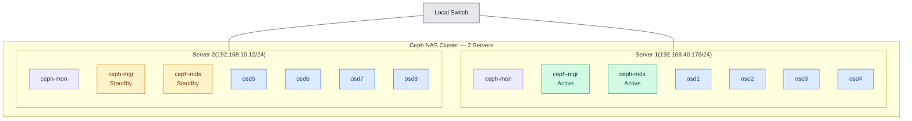

1. **With Six servers (iniital plan)**

```mermaid

flowchart TB
    SW["Local Switch"]
    
    subgraph CLUSTER["Ceph NAS Cluster — 6 Servers"]
        direction LR
        
        subgraph S1["Server 1(192.168.10.11/24)"]
	        direction TB
            MON1["ceph-mon"]
            MGR1["ceph-mgr<br/>Active"]
            D1["osd1"]
            D2["osd2"]
        end
        
        subgraph S2["Server 2(192.168.10.12/24)"]
	        direction TB
            MON2["ceph-mon"]
            MGR2["ceph-mgr<br/>Standby"]
            D3["osd3"]
            D4["osd4"]
        end
        
        subgraph S3["Server 3(192.168.10.13/24)"]
	        direction TB
            MON3["ceph-mon"]
            MDS1["ceph-mds<br/>Active"]
            D5["osd5"]
            D6["osd6"]
        end
        
        subgraph S4["Server 4(192.168.10.14/24)"]
	        direction TB
            MDS2["ceph-mds<br/>Standby"]
            D7["osd7"]
            D8["osd8"]
        end
        
        subgraph S5["Server 5(192.168.10.15/24)"]
	        D9["osd9"]
	        D10["osd10"]
        end
        
        subgraph S6["Server 6(192.168.10.16/24)"]
	        D11["osd11"]
	        D12["osd12"]
        end
    end
    
    SW --- S1
    SW --- S2
    SW --- S3
    SW --- S4
    SW --- S5
    SW --- S6
    
    classDef active fill:#d1fae5,stroke:#059669,color:#064e3b
    classDef standby fill:#fef3c7,stroke:#d97706,color:#78350f
    classDef disk fill:#dbeafe,stroke:#2563eb,color:#1e3a8a
    classDef switch fill:#e5e7eb,stroke:#4b5563,color:#111827
    
    class MGR1,MDS1 active
    class MGR2,MDS2 standby
    class D1,D2,D3,D4,D5,D6,D7,D8,D9,D10,D11,D12 disk
    class SW switch
```

2. **With 2 servers**

## Common prerequisites in hosts
- container engine (docker / podman) installed
- ntp / chronyd (enable timesynchronization)
- lvm2 installed
- install ceph-common (via cephadm install or apt)

# Ceph Quorum

> Ceph Quorum is a state in which machine failures upto a limit can be overcome by other monitor.

In an evironment with N systems, for achiving quorum, there must be ( N / 2 ) + 1 ceph-mon isntances at minimum

